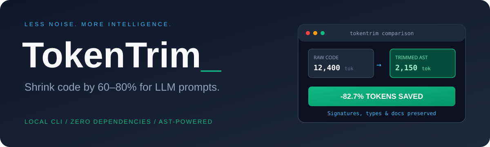
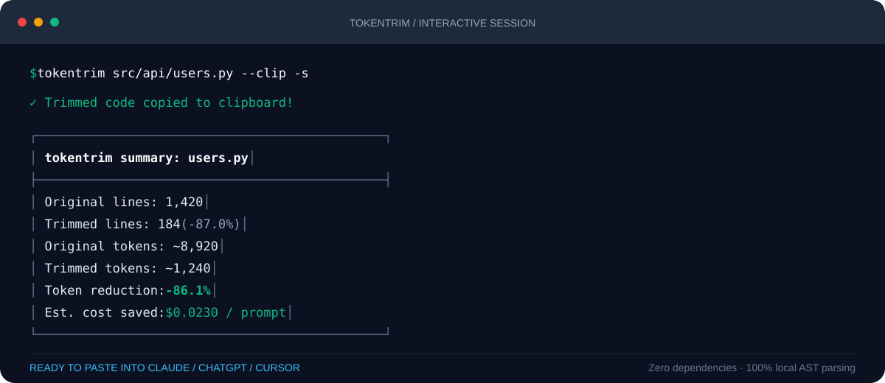

<p align="center"><strong>English</strong> · <a href="README.ru.md">Русский</a></p>

<p align="center">
  
</p>

<p align="center">
  <a href="https://github.com/Palladiymateria/tokentrim/actions/workflows/tests.yml"></a>
  
  <a href="LICENSE"></a>
  
  <a href="https://github.com/Palladiymateria/tokentrim/stargazers"></a>
</p>

<p align="center">
  <strong>Shrink your codebase by 60–80% for LLM context windows.</strong><br>
  Extract signatures, types, and interfaces while collapsing implementation details.<br>
  No API keys, no network calls, zero runtime dependencies.
</p>

<p align="center">
  <a href="#quick-start">Quick start</a> ·
  <a href="#before--after">Before & After</a> ·
  <a href="#commands--options">Options</a> ·
  <a href="#supported-languages">Languages</a> ·
  <a href="#how-it-works">How it works</a>
</p>

---

<p align="center">
  
</p>

## Why TokenTrim?

When collaborating with AI coding assistants (Claude, ChatGPT, Cursor, DeepSeek, Copilot), pasting whole repositories or large files quickly exhausts context limits, degrades reasoning accuracy, and increases API costs.

In 90% of prompt workflows, **the LLM doesn't need private implementation logic** — it needs:
* **Function & method signatures**
* **Type hints and return types**
* **Class structures & dataclasses**
* **Docstrings and API contracts**

**TokenTrim** uses native AST analysis to strip away internal loops, private computations, and bulky boilerplate while keeping the code **syntactically valid** and semantically intact.

---

## Before & After

### Raw Python (52 lines · ~460 tokens)
```python
class PaymentProcessor:
    """Processes recurring billing cycles and handles payment retries."""

    def __init__(self, api_key: str, max_retries: int = 3):
        self.api_key = api_key
        self.max_retries = max_retries
        self._session = self._init_session()

    def charge(self, user_id: str, amount_cents: int) -> TransactionResult:
        """Charges user payment card with exponential backoff retries."""
        for attempt in range(self.max_retries):
            try:
                raw_resp = self._session.post(
                    "https://api.stripe.com/v1/charges",
                    headers={"Authorization": f"Bearer {self.api_key}"},
                    json={"customer": user_id, "amount": amount_cents},
                )
                if raw_resp.status_code == 200:
                    return TransactionResult(status="success", id=raw_resp.json()["id"])
            except NetworkError as err:
                time.sleep(2 ** attempt)
        raise PaymentFailedError(f"Failed to charge user {user_id}")
```

### Trimmed Skeleton (12 lines · ~85 tokens — **81.5% saved**)
```python
class PaymentProcessor:
    """Processes recurring billing cycles and handles payment retries."""

    def __init__(self, api_key: str, max_retries: int=3):
        ...

    def charge(self, user_id: str, amount_cents: int) -> TransactionResult:
        """Charges user payment card with exponential backoff retries."""
        ...
```
*(Notice how the docstring, class hierarchy, method names, and type annotations are completely preserved, while 40 lines of implementation logic are replaced with idiomatic Python ellipses `...`)*

---

## Quick start

Requires **Python 3.10 or newer**. Works on Windows, macOS, and Linux without installing third-party libraries.

### 1. Clone or Download
```sh
git clone https://github.com/Palladiymateria/tokentrim.git
cd tokentrim
```

### 2. Run immediately
Zero package installation required:

```sh
# Trim a single file and copy directly to your clipboard
python -m tokentrim src/services/auth.py --clip

# Trim an entire directory and see token savings
python -m tokentrim src/ --stats

# Strip docstrings for extreme compression
python -m tokentrim src/ --no-docstrings --clip
```

### 3. (Optional) Install globally via pip
```sh
pip install -e .
tokentrim src/api/users.py --clip -s
```

---

## Commands & Options

```text
usage: tokentrim [-h] [-c] [-o FILE] [-s] [--no-docstrings] [-e EXCLUDE] [--json] [-v] [target]

Shrink your codebase by 60-80% for LLM context prompts. Zero dependencies, 100% local.

positional arguments:
  target                Path to file or directory to trim (default: .)

options:
  -h, --help            Show this help message and exit
  -c, --clip            Copy trimmed output directly to system clipboard
  -o FILE, --output FILE
                        Write trimmed output to destination file
  -s, --stats           Display detailed token and line reduction statistics
  --no-docstrings       Strip docstrings for maximum token reduction
  -e, --exclude PATTERN Glob pattern to exclude (can be repeated)
  --json                Output results as machine-readable JSON
  -v, --version         Show program's version number and exit
```

---

## Common Use Cases

### 1. Instant Clipboard Context (`--clip`)
Trim a source file and copy it directly to your clipboard, ready to paste into Claude or ChatGPT:
```sh
tokentrim src/core/engine.py -c
```

### 2. Multi-file Markdown Bundle for AI
When targeting a directory, `tokentrim` bundles all trimmed files into neatly labeled Markdown blocks:
```sh
tokentrim ./lib --output prompt_context.md --stats
```

### 3. Piping into other tools
Integrates cleanly into your terminal pipeline:
```sh
tokentrim src/main.py | pbcopy       # macOS
tokentrim src/main.py | clip.exe     # Windows
```

---

## Supported Languages

| Language | Extensions | Skeletons Preserved |
| :--- | :--- | :--- |
| **Python** | `.py` | AST: classes, dataclasses, methods, functions, types, decorators, docstrings, `__all__` |
| **TypeScript** | `.ts`, `.tsx` | Interfaces, types, class declarations, function signatures |
| **JavaScript** | `.js`, `.jsx`, `.mjs` | Classes, exported functions, method signatures |
| **Go** | `.go` | Packages, imports, structs, interfaces, func signatures |
| **Rust** | `.rs` | Traits, structs, enums, impl declarations, fn signatures |

---

## The Palladiymateria Tool Suite

`tokentrim` is designed to work seamlessly with:
* [**RepoMap**](https://github.com/Palladiymateria/repomap) — Turn your repository directory into a readable tree and context map.
* [**ShareCheck**](https://github.com/Palladiymateria/sharecheck) — Scan your local workspace for accidental secrets before publishing.
* [**TokenTrim**](https://github.com/Palladiymateria/tokentrim) — Condense code into token-efficient skeletons for LLM context prompts.

---

## Development & Testing

Run the full test suite using Python's built-in `unittest`:

```sh
python -m unittest discover -s tests -v
```

---

## License

[MIT](LICENSE) © 2026 Palladiy
